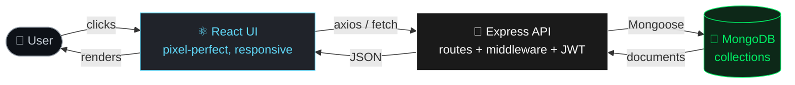

<!-- ============================================================
  Profile README: Rohit Shrivastava (rohit-engineering)
  MERN Full-Stack Project Lab
  Setup: public repo named "rohit-engineering" -> README.md
  Edit anything marked ✏️
============================================================ -->

<div align="center">


<a href="https://github.com/rohit-engineering">
  
</a>

<br/><br/>


<br/><br/>


</div>

<br/>

## 🖥️ `$ whoami`

```bash
rohit@project-lab:~$ cat about.sh

  ┌──────────────────────────────────────────────────────────┐
  │  NAME      : Rohit Shrivastava                           │
  │  ROLE      : MERN Full-Stack Developer                   │
  │  MISSION   : Build projects. Break things. Ship them.    │
  │  LOVES     : DB ↔ Backend ↔ Frontend wiring, slick UI    │
  │  MODE      : Always exploring new tech 🚀                │
  │  ACCOUNT   : 100% dedicated to projects                  │
  └──────────────────────────────────────────────────────────┘

rohit@project-lab:~$ _
```

<br/>

## 🔌 How I Wire Things Together



<br/>

## 📡 `GET /api/rohit`

```json
{
  "status": 200,
  "developer": {
    "name": "Rohit Shrivastava",
    "stack": ["MongoDB", "Express.js", "React", "Node.js"],
    "superpowers": [
      "Connecting database to backend to frontend",
      "Crafting awesome, polished UI",
      "Turning ideas into working projects"
    ],
    "currentlyExploring": ["Next.js", "TypeScript", "Docker", "Socket.io", "GraphQL", "AI APIs"],
    "philosophy": "If it exists, I want to build with it.",
    "openToCollab": true
  }
}
```

<br/>

## 🧰 `package.json` of my skills

<div align="center">

| Layer | Tech |
|:-----:|:-----|
| 🎨 **Frontend** |  |
| ⚙️ **Backend** |  |
| 🗄️ **Database** |  |
| 🛠️ **Tools** |  |
| ☁️ **Deploy** |  |
| 🧪 **Exploring** |  |

</div>

```> ✏️ Remove any icon you haven't used yet; add ones you have. Full list: [skillicons.dev](https://skillicons.dev)```

<br/>

## 🧪 Project Lab

<div align="center">

| 🚀 Project | 📝 What it does | 🧱 Stack | 📶 Status |
|:----------|:---------------|:--------|:---------:|
| **[Project One](https://github.com/rohit-engineering/your-repo)** ✏️ | Full-stack app with auth + CRUD | `MERN` |  |
| **[Project Two](https://github.com/rohit-engineering/your-repo)** ✏️ | Real-time chat / dashboard | `React` `Socket.io` |  |
| **[Project Three](https://github.com/rohit-engineering/your-repo)** ✏️ | E-commerce / blog / tracker | `MERN` `Stripe` |  |

</div>

<br/>

## 🧭 Roadmap: Always Levelling Up

- [x] Build full MERN apps with auth (JWT) and CRUD
- [x] Connect MongoDB ↔ Express ↔ React end to end
- [ ] Master **TypeScript** across the whole stack
- [ ] Learn **Next.js** (SSR / SSG / App Router)
- [ ] Add **real-time** features with Socket.io
- [ ] **Dockerize** projects and set up CI/CD
- [ ] Explore **GraphQL**, **Redis**, and **AI/LLM APIs**
- [ ] Contribute to open source

<br/>

## 📊 Dev Stats

<div align="center">


</div>

<br/>

## 🐍 Contribution Snake

<div align="center">

<picture>
  <source media="(prefers-color-scheme: dark)" srcset="https://raw.githubusercontent.com/rohit-engineering/rohit-engineering/output/github-snake-dark.svg"/>
  <source media="(prefers-color-scheme: light)" srcset="https://raw.githubusercontent.com/rohit-engineering/rohit-engineering/output/github-snake.svg"/>
  
</picture>

</div>

<br/>

## 📬 `POST /api/contact`

<div align="center">

<a href="mailto:engineerrohit10@gmail.com"></a>
<a href="https://www.linkedin.com/in/engineerrohit01"></a>
<a href="https://engineerrohit01.vercel.com"></a>

```json
{ "message": "Let's build something awesome together 🤝", "status": "open to collaborate" }
```

</div>


<div align="center">

`console.log("Thanks for stopping by! ⭐ a repo if you like what you see.");`

</div>
